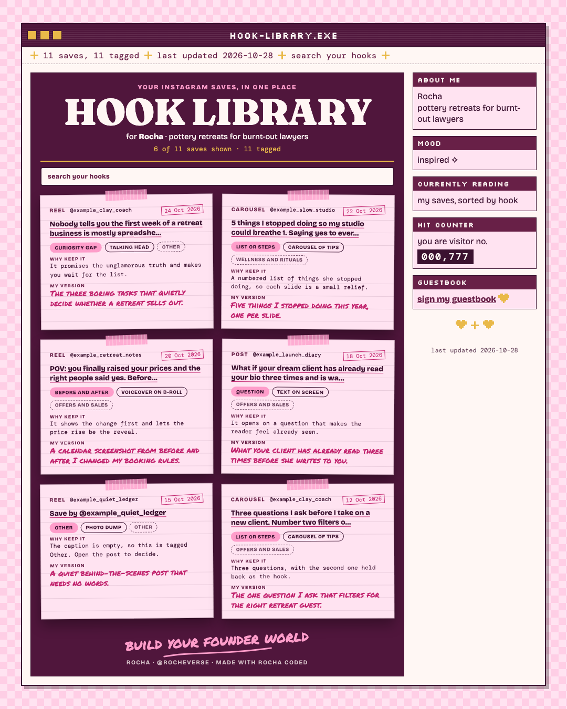
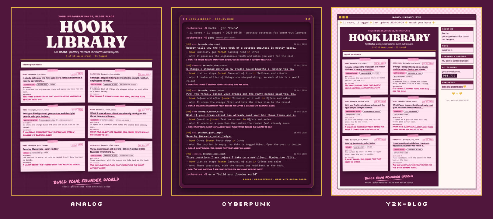

# Instagram Saves to Notion

*Rocha Coded. Free tools from the Rocheverse.*

**Your Instagram saves become a searchable hook library in Notion.**

You have been saving posts for months, and you cannot find a single one when you need it.
This reads your saved posts, sorts them by the kind of hook they use, and writes your own idea beside each one.
You get a library you can search, in a web page and in Notion.
No keys, no tokens. It runs through your own logged-in Chrome.

<p align="center"></p>

<p align="center"></p>

<p align="center"><sub>One library, three moods: analog, cyberpunk, y2k-blog. A made-up pottery retreat. Every post and handle on it is fictional.</sub></p>

## Start here
You can do this. Each step tells you what to type and what you will see when it worked.

**Before you start:** you need Google Chrome with the Claude in Chrome extension (it lets Claude see a tab you open, and only that), and you need to be logged in to instagram.com in that Chrome.
Notion is optional.

**If you use Claude Code** (Claude in the terminal, the window where you type commands to your computer):

 Open the Terminal app. On a Mac it is in Applications > Utilities > Terminal.
   This checks that Python, the language the tool is written in, is ready:
   ```sh
   python3 --version
   ```
   You will see `Python 3.10` or a higher number.

 This copies the tool onto your computer. "Clone" means download a copy from GitHub, the site where the code lives:
   ```sh
   git clone https://github.com/RochaStone/ig-saves-to-notion ~/.claude/skills/ig-saves-to-notion
   ```
   You will see `Cloning into...` and then the line where you type comes back.

 This makes a folder for your saves and opens Claude Code inside it:
   ```sh
   mkdir -p ~/ig-saves && cd ~/ig-saves && claude
   ```
   You will see Claude Code open and wait for you.

 Type this to Claude, in your own words if you like:
   ```
   Make a hook library from my Instagram saves.
   ```
   You will see Claude ask your first question, about your niche. It asks one thing at a time, and it tells you before it opens Instagram.

 When Claude says your library is ready, this opens it in your browser:
   ```sh
   open out/library.html
   ```
   You will see your saves as cards, with a search box. Type a word you keep using.

**If you use Claude Cowork** (the Claude desktop app): download the zip (one file that holds the whole tool),
upload it in Customize > Skills, give a task your saves folder, and say "Make a hook library from my Instagram saves."
The full steps are under [Claude Cowork](#claude-cowork).

<p align="center"></p>

## What you get
- **The library page.** One file, `library.html`, that opens in any browser. Every save is a card with its hook type, its format, why it is worth keeping and a line for your own version. Search by any word, or filter by hook type and category. Pick your look: analog, cyberpunk or y2k-blog.
- **Your hooks, sorted.** Claude reads each caption and names the hook: curiosity gap, proof first, pain point, contrarian, question, story open, before and after, list or steps, relatable moment. You can change any of them.
- **A Notion database, if you want one.** The same saves as rows you can filter, group and add to. Claude can make the database for you.
- **Only the new ones, next time.** Run it again in a few weeks. It remembers what you already have and brings only the new saves.

<p align="center"></p>

## Install
It runs inside Claude. Nothing to host, no account to make, and your saves stay on your computer.

| Where you use it | Install it | Start it |
|---|---|---|
| [Claude Code](#claude-code) (recommended) | clone into `~/.claude/skills` | ask "make a hook library from my Instagram saves" |
| [Claude Cowork](#claude-cowork) | upload `ig-saves-to-notion.zip` as a skill | ask for the hook library in a Cowork task |

You need Python 3.10 or newer, and Google Chrome with the Claude in Chrome extension.
Node is not needed to use it. It is only used by the tests.

### Claude Code
```sh
git clone https://github.com/RochaStone/ig-saves-to-notion ~/.claude/skills/ig-saves-to-notion
```
Open Claude Code in the folder where you want your saves kept, and ask: "Make a hook library from my Instagram saves."
To update later: `git -C ~/.claude/skills/ig-saves-to-notion pull`.

### Claude Cowork
Cowork (the Claude desktop app) runs tasks in a sandbox on your computer that can only reach the folders you give it.
1. Download `ig-saves-to-notion.zip` from the [latest release](https://github.com/RochaStone/ig-saves-to-notion/releases/latest).
2. In the Claude desktop app: Customize > Skills, then + > Create skill > Upload a skill, and pick the zip.
3. In Settings > Capabilities, turn on code execution and file creation.
4. Make a folder for your saves, for example `ig-saves` in your home folder. Start a Cowork task, give it access to that folder, and ask: "Make a hook library from my Instagram saves."

Reading your saved posts needs the Claude in Chrome extension to be connected to your Cowork session.
If it is not, Claude says so kindly and offers paste mode, where you paste your saves in by hand.
If the saves file cannot be saved to the folder you shared, Claude reads it off the page in small pieces instead.

<p align="center"></p>

## How it works
1. **Claude asks you four things:** your niche, the categories you want your saves filed under, whether you want everything or only recent saves, and whether you want Notion too.
2. **It reads your saved list.** In your own logged-in Instagram tab, a small script asks Instagram for your saved posts, the same way the Saved page does when you open it. It goes one page at a time with a pause between, and it keeps the results in that tab until Claude brings them home. Your login never leaves your browser. If you set a start date, it compares the date the creator posted, because Instagram does not share when you saved a post, and it stops when a whole page is older than your date.
3. **It tags each save.** Claude reads the caption and fills in four things: the hook type, the format, why it is worth keeping and an idea of your own. The wording lives in `tag.md`, so you can edit it.
4. **It builds your library.** `library.html` for the browser, and rows in Notion if you asked for them.

Notion has two ways in. The easy one is the Notion connector in Claude, which needs no token.
The other is `notion_push.py`, for people who like to run things by hand. It uses a Notion token (a private password you make in Notion for one program), kept in a `.env` file (a small private settings file that stays on your computer).
Copy `.env.example` to `.env` and paste your own token there. Never paste a token into the chat.
The database layout is in `notion_template.md`.

### A note on Instagram's rules
Instagram's terms of service do not welcome automated tools, and the page this reads is an internal one that can change or slow down without notice.
This tool reads only your own saved list, from your own logged-in browser, at a calm pace, with a hard limit on pages. It never follows, likes, saves or unsaves anything, and it never stores your login.
It is your account and your decision. If Instagram asks you to confirm it is you, or says to slow down, stop and come back later.
This is a note to be careful, not legal advice.

### Your saves are private
`saves.json` and `library.html` hold your saved captions and the handles of the creators you saved. They stay on your computer, and the repo's `.gitignore` keeps them out of git.
Think before you share a screenshot of your own library.

<p align="center"></p>

## If it goes wrong (everyone's first time) 
This happens to everyone the first time. Here are the three most common moments and the fix for each.
- **Claude says "not logged in to Instagram in this browser".** Open instagram.com in Chrome, log in yourself, then tell Claude "ready". Claude never types a password for you.
- **Claude says Instagram returned an error, or asks you to wait.** That is Instagram asking for a slower pace. Close the tab, wait an hour or more, and ask Claude to try again. It carries on where it left off.
- **The terminal says `command not found` for `python3` or `git`.** Your Mac may offer to install its developer tools. Click Install, wait for it to finish, and run the step again. If nothing pops up, install Python from python.org.

<p align="center"></p>

## Make it yours
Your look lives in one file, `style.json`: your colours, fonts, your own scrawl line, and your name and handle on the page.
It ships with two examples: `examples/style.rocha-coded.json` (my plum and pink) and a blank `style.example.json` for yours, explained in `STYLE.md`. Or ask Claude to make one with you from a few references.
Pick your motif, `analog`, `cyberpunk` or `y2k-blog`, to change the structure. Your palette and fonts re-tone all three, so every version is yours to curate.
The same file works across every Rocha Coded tool, so you make it once.

Your categories, your niche and your cutoff date live in `config.json`, made from `config.example.json`.

## What's inside
| File | What it does |
|---|---|
| `SKILL.md` | the steps Claude follows: your choices, the sync, the tagging, the library, Notion |
| `browser_sync.js` | runs in your own logged-in Instagram tab and reads your saved posts |
| `saves.py` | the small command line Claude uses to merge, tag, build the library and prepare Notion rows |
| `saves_core.py` | the shared code: settings, parsing, categories, tags and the Notion row shapes |
| `library_render.py` | draws `library.html` in all three motifs from one function |
| `style_loader.py` | finds and reads your `style.json` |
| `notion_push.py` | optional: push to Notion with your own token, instead of the connector |
| `tag.md` | the tagging prompt Claude follows, which you can edit |
| `notion_template.md`, `notion/schema.json` | the Notion database: every property and its type |
| `assets/` | the three looks: `library.css` (analog), `motif-cyberpunk.css`, `motif-y2k.css` |
| `package.json` | tells Node that `browser_sync.js` is a plain script (only the tests use Node), and gives `npm test` |
| `config.example.json`, `.env.example` | your settings, and where an optional Notion token goes |
| `examples/` | a fictional sample (tagged saves and a library page) and Rocha's example style |
| `scripts/make-readme-images.py` | makes every image in this README from the tool itself, listed in `docs/IMAGES.md` |
| `tests/` | the tests, the fictional Instagram pages they use, and `tests/TESTING.md` with exactly what was run |
| `style.example.json`, `STYLE.md` | your look in one file, and what each key does |

Everything is plain Python from the standard library, and one browser script. No packages to install.
The library page loads its fonts from Google Fonts and falls back to fonts already on your computer when you are offline.

For the curious, build the sample library by hand:
```sh
python3 saves.py --saves examples/saves.sample.json library --motif cyberpunk --out out/
```

## Licence
MIT. See [LICENSE](LICENSE). Copyright (c) 2026 Rochelle Livingstone / Thriving Era Studio.

 [Sign my guestbook](https://github.com/RochaStone/ig-saves-to-notion/issues)

## Made by Rocha

Rocha \
Brand Alchemist & AI Architect \
Author of *Brand Alchemy in the Thriving Era* and *Thriving in Transformational Times* \
Creator of [Conscious Founder Operating System](https://founders.thrivingera.com) \
Founder, [Thriving Era Studio](https://thrivingera.com)

I help female founders build their founder world, and I build what they need next. \
Start with the audit: [thrivingera.com/audit](https://thrivingera.com/audit). \
Or book an exploratory call: [calendly.com/rochelle-thrivingera/exploratory-call](https://calendly.com/rochelle-thrivingera/exploratory-call). It is where we decide if we work together.

[Instagram @rocheverse](https://instagram.com/rocheverse) · [Substack](https://rochastone.substack.com) · [LinkedIn](https://www.linkedin.com/in/rochellelivingstonecosmic) · [More free tools](https://thrivingera.com/free) · [All tools on GitHub](https://github.com/RochaStone)
